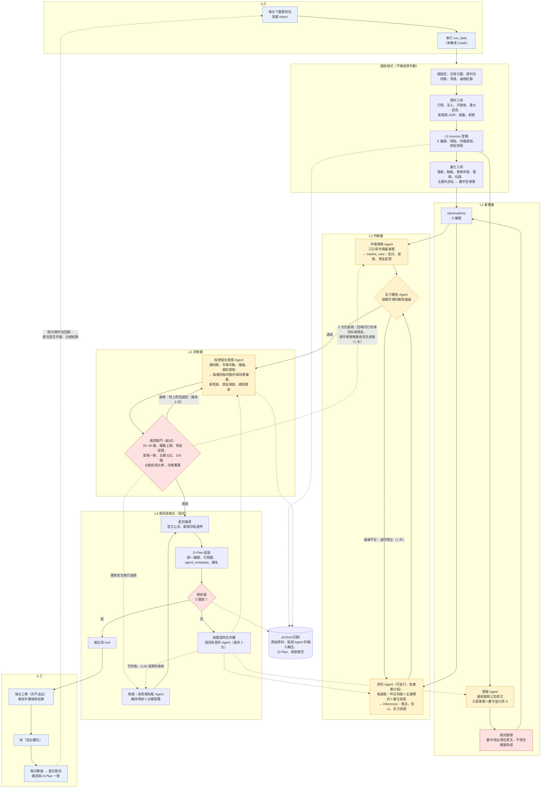

# 多 Agent 產出 D-Plan 流程圖

> 更新日期：2026-10-25。在 Cursor 或 GitHub 開啟本檔即可看到圖（Mermaid）。

## 1. 設計重點

- **投資決策由 Agent 產生**：選股、加減碼、目標權重、資金調度，都由「投資組合經理 Agent」決定。
- **程式只負責三件事**：抓資料與計算數字、檢查規則（風控閘門、檢查器）、依官方公式把決策換算成委託股數。程式**不替 Agent 做投資判斷**；違規時退回給 Agent 修正，只有修正失敗才改用規則版。
- **資訊傳遞依照 D-Plan 的分層規定**：每個 Agent 只能讀上一層的結果，輸出時必須引用上一層的編號（L0 來源 → L1 事實 → L2 市場判斷與推論 → L3 決策 → L4 委託），不能有斷環，也不能憑空產生數字。
- **每個 Agent 都有「LLM 版」與「規則版」兩種實作**，介面相同。LLM 接上前先用規則版跑通流程；LLM 失敗時自動換成規則版，保證當天一定交得出合法的 D-Plan。

## 2. 流程圖

圖例：黃色是 LLM Agent，紅色是程式把關（不做判斷、只檢查），藍色是人工步驟，其餘是程式。

## 3. 各 Agent 的資訊契約

每個 Agent 的輸入輸出都是固定的 JSON 結構，欄位直接對應 D-Plan 的分層。

| Agent | 讀取（只能引用這些編號） | 產出 | 對應 D-Plan |
|---|---|---|---|
| 情報 Agent | 新聞、公告原文（S） | 事實敘述＋數字，每筆引用 S | `observations`（文字型） |
| 市場策略 Agent | 市場級事實（O：大盤、美股、夜盤、匯率、總經） | 走向、姿態、淨曝險意圖、現金區間、反方訊號 | `market_view` |
| 研究 Agent | 候選股相關事實（O） | 每檔看法、信心、推導過程、反方訊號 | `inferences` |
| 反方審查 Agent | `market_view`、`inferences` | 補強或修正反方訊號；論據不足者退回 | `counter_evidence` |
| 投資組合經理 Agent | 持股與淨值、`market_view`、`inferences`、規則限制 | 每檔持股的動作（BUY／ADD／TRIM／SELL_ALL）與目標權重、續抱理由、資金調度 | `decisions`、`no_trade_decisions` |
| 程式：委託推導 | `decisions`、淨值、前日收盤價、現持股 | 委託方向與股數 | `orders` |

**編號規則**：Agent 之間傳遞時使用暫時代號，最後由調度程式統一重新編成 `S1…`、`O1…`、`I1…`、`D1…`（從 1 開始、連續、不加前導零），並同步更新所有引用。

**數字規則**：Agent 不可自己產生數字型事實。數字一律來自量化工具或原文，情報 Agent 寫的數字由程式比對原文驗證。

## 4. 退回與降級規則

| 狀況 | 處理 | 上限 |
|---|---|---|
| 反方審查認為推論論據不足 | 退回研究 Agent 修正；仍不足就排除該推論 | 1 次 |
| 風控閘門發現違規（例如權重超限、檔數不足、現金超出區間、姿態與委託方向矛盾、成交價差 3% 時現金會變負數） | 把違規項目與數字退回投資組合經理 Agent 修正 | 3 次 |
| 投資組合經理 3 次都做不到市場策略宣告的姿態（例如強制減碼釋出大量現金，無法維持 hold） | 把可行方案的淨流向與現金比回報市場策略 Agent，重新宣告姿態與現金區間，投資組合經理再做一輪 | 1 次 |
| 檢查器有錯誤 | 依錯誤所在的層退回負責的 Agent（事實層 → 情報；推論 → 研究；決策 → 投資組合經理） | 2 次 |
| 超過上限、LLM 無回應、資料源失敗 | 該 Agent 改用規則版；最壞情況是「維持現狀＋必要調整」（被動超限減碼、現金與檔數修正） | — |

所有退回紀錄都存在 `archive/日期/`，供日後檢討與抽檢說明。
